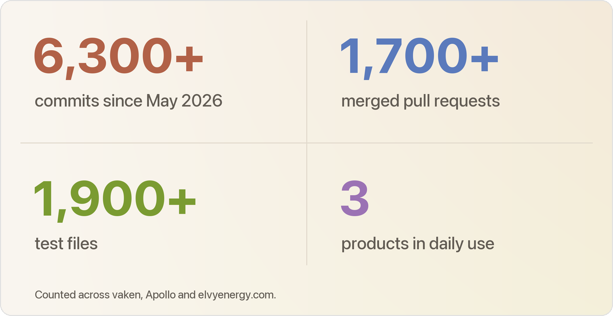
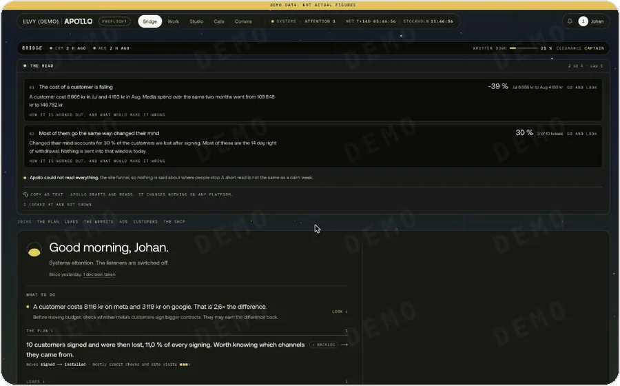

<picture><source media="(prefers-color-scheme: dark)" srcset="assets/banner-dark.png"></picture>

I run marketing at [Elvy](https://www.elvyenergy.com/) in Stockholm, and I build most of the tools we use. The website I rebuilt converts **3.2× better** than the old one, and it keeps climbing. Next.js and Supabase on Vercel, all of it written with Claude Code.

<picture><source media="(prefers-color-scheme: dark)" srcset="assets/stats-dark.png"></picture>

Counted across vaken, Apollo and elvyenergy.com.

## elvyenergy.com: 3.2× the conversion

<picture><source media="(prefers-color-scheme: dark)" srcset="assets/uplift-dark.webp"></picture>

The new site more than doubled conversion in its first month. Then it kept climbing, one tested change at a time. Paid traffic now converts 3.7× better than the old site did.

<table>
<tr>
<td width="50%"> <b>The site.</b> Swedish and English, with an onboarding flow that looks up your house from your address. <a href="https://www.elvyenergy.com/">Visit it</a></td>
<td width="50%"> <b>The design system.</b> Public, and it renders the real components. <a href="https://www.elvyenergy.com/design-system">Open it</a></td>
</tr>
</table>

<b>How the site is built</b>

 

- **Figma first.** The design system came first, then mockups built from it. Then it became code: tokens for colour, type, spacing, radii and shadows, and components that use only those tokens.
- **Styling is never invented.** All tokens live in one file. A lint rule blocks any value that is not a token, so no person or model can slip in a one-off colour or margin.
- **No CMS.** You ask an AI coding agent for a change and drop in the images. It edits the right file and opens a pull request with a preview link. Nothing goes live on its own.
- **One gate for every change.** Formatting, lint, type check, tests, contrast and document structure, and a check that the generated CSS still matches the tokens.
- **Speed to lead.** A lead is only worth something if sales calls back fast. Every new lead is contacted within five minutes, sales works from a call queue, and quiet leads get a 60-day follow-up in HubSpot.
- **Measured honestly.** Brand-awareness traffic converts at about 0.2 %, so it would hide real gains. We read conversion with and without it, side by side.

Stack: Next.js (App Router), React 19, TypeScript, Tailwind v4, next-intl, React Email, Vercel. [Full write-up](https://github.com/johanmatsgard/elvy-web-case-study)

## Apollo: one marketer, a whole team's output

Recorded on a demo brand with invented data.

**The goal: one marketing lead with the output of a full in-house team plus a performance agency.** Apollo is the ship's computer for that crew of one. It sees every channel next to the company's real numbers, remembers every decision, learns from every correction, and says what to do next and why. It thinks and drafts. The human always decides.

<b>Where it's headed</b>

 

- **A brain that compounds.** Apollo keeps a ledger of what it was told, a log of what was decided and a library of what worked. Every answer shows what it drew on. Every correction and every click makes the next answer better.
- **Numbers you can feel.** The funnel, the ribbons, the planets and the flight path turn a dashboard into a scene you read in a second, with the detail two clicks away.
- **Every role, one place.** Analyst, strategist, copywriter, media buyer: each is a role Apollo plays inside a workflow, in Elvy's own voice.
- **Better models, for free.** The intelligence lives in the scaffolding, not in one model. When a stronger model ships, all of Apollo gets smarter the same day.

<b>What runs today</b>

 

- Meta, TikTok, Google and LinkedIn in one view, next to signed customers straight from Firestore. Nobody types numbers in by hand.
- No unfair rankings: channels that count conversions differently are never ranked against each other.
- Recommendations the team marks as implemented, skipped or watching, so nothing is forgotten.
- Drafts press releases and debate articles in Elvy's voice.
- Built in Claude Code loops (ship, data, brain, adoption). Changes land on a preflight branch first, and I merge to main myself.

Stack: Next.js 16, Supabase (EU), Inngest, Anthropic SDK, Vercel. [Full write-up](https://github.com/johanmatsgard/apollo-case-study)

## vaken: mission control for Claude Code

<picture><source media="(prefers-color-scheme: dark)" srcset="assets/vaken-hero-dark.webp"></picture>

Run ten Claude Code sessions and still know exactly where each one stands. vaken is my first public plugin. It looks like part of the app, stops risky steps like `git reset --hard` when Claude Code would not ask first, and keeps all its data on your computer.

<table>
<tr>
<td width="50%"><picture><source media="(prefers-color-scheme: dark)" srcset="assets/vaken-needs-dark.webp"></picture> <b>Needs you.</b> Every session that waits for you, in one list.</td>
<td width="50%"><picture><source media="(prefers-color-scheme: dark)" srcset="assets/vaken-limits-dark.webp"></picture> <b>Plan limits.</b> What is left, and when it resets.</td>
</tr>
<tr>
<td><picture><source media="(prefers-color-scheme: dark)" srcset="assets/vaken-context-dark.webp"></picture> <b>Context.</b> How full the chat is, and when to compact.</td>
<td><picture><source media="(prefers-color-scheme: dark)" srcset="assets/vaken-agents-dark.webp"></picture> <b>Agents.</b> What every helper does, and what it costs.</td>
</tr>
</table>

<b>How it's built</b>

 

- **Native first.** Every size and colour is measured from Claude Code Desktop in points and kept in one tokens file. A check fails the build on any raw number.
- **Safety guards.** It reads each tool call before it runs. Deletes, force-pushes and wipes stop and wait for your OK when Claude Code would not ask first.
- **Private by design.** No account, no server. Everything stays in a local file on your computer.
- **Tested in CI.** Every pull request runs the checks on Mac and Windows before it can merge.

**[Install vaken](https://github.com/johanmatsgard/vaken)** · [Guide](https://github.com/johanmatsgard/vaken/blob/main/docs/guide.md)

## How I work

<table>
<tr>
<td width="50%"><picture><source media="(prefers-color-scheme: dark)" srcset="assets/loop-dark.png"></picture> <b>Design loop.</b> A design team that never stops. Claude Code loops design new screens from the design system, test them against a goal, and fork a fresh idea after two cycles. It is how new pages for the site get designed. <a href="https://github.com/johanmatsgard/design-loop">How it works</a></td>
<td width="50%"><picture><source media="(prefers-color-scheme: dark)" srcset="assets/huskartan-dark.png"></picture> <b>Huskartan.</b> Built to score every house in Sweden. Public data tells which homes gain most from a new heating system, when they are likely to act, and how good the roof is for solar. One PDF report per address. <a href="https://github.com/johanmatsgard/huskartan-case-study">How it works</a></td>
</tr>
</table>

<b>More on the design loop</b>

 

A design system gives you the parts. The loop decides what a page should do with them. It starts from a goal, like getting a customer to book a visit, and designs answers using only parts from the system.

- **CONVERT** gets the key action done. **VOICE** checks copy and numbers. **CRAFT** adds the details that make it feel distinct.
- Each run ends with a review card: what changed, why, and what to try next. I read it and steer.
- After two cycles the version is frozen, and the loop must try a new idea, not a restyle.
- Judged on a phone first. Mock data only.

**Now:** reading every recorded sales call to learn what makes people sign (Sonnet reads, Opus reviews), and [testing an AI moderator on 100 Swedish social media comments](https://github.com/johanmatsgard/jev-svenska-triage).

Building something like this, or hiring for it? [Message me on LinkedIn](https://www.linkedin.com/in/johanmatsgard/).
