<picture><source media="(prefers-color-scheme: dark)" srcset="assets/banner-dark.png"></picture>

<p align="center"><a href="https://www.linkedin.com/in/johanmatsgard/">LinkedIn</a> · <a href="https://github.com/johanmatsgard/vaken">vaken</a> · <a href="https://www.elvyenergy.com/design-system">Elvy design system</a></p>

**I lead growth and brand, and I build the AI that scales it.** Today I am Head of Marketing at Elvy in Stockholm, part of its leadership team, where I lead a small team. Since I joined in March, leads from partners and bought lists fell from 85% to 6% of the total, and leads from our own channels per day grew about 9×. Before that, I co-founded Digital Fans and led it as Nordic CEO for twelve years. We combined with NORD DDB to become a group of 300+ people across the four Nordic countries, where I also led growth strategy and digital transformation. Along the way my teams and I have worked with McDonald's, Vattenfall, Klarna, Nordea, SKF, Volkswagen, Telenor, Verifone, MTG, ABBA The Museum and UN Women, among them some of the region's award-winning campaigns.

**What I lead.** Brand, growth and demand generation at Elvy: positioning, every acquisition channel, partnerships, and the customer journey from first visit to signed contract. I own the growth numbers on the leadership team.

I direct the AI agents that write the code, and I own the result. Since May I have shipped three systems: elvyenergy.com, which converts 4.5× better than the old site; Apollo, the AI marketing crew I build for our team; and vaken, open-source mission control for Claude Code. I set the plan, agents build, a gate checks every change, and nothing ships without my sign-off.

### Featured

<table>
<tr>
<td width="33%"><a href="#elvyenergycom-a-website-marketing-runs-without-a-developer-queue"><picture><source media="(prefers-color-scheme: dark)" srcset="assets/featured-elvy.webp">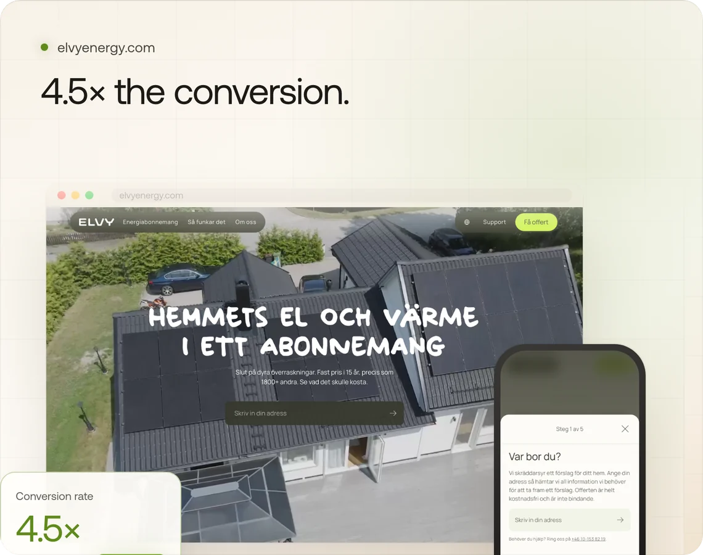</picture></a></td>
<td width="33%"><a href="#apollo-a-small-team-with-the-reach-of-a-big-one"><picture><source media="(prefers-color-scheme: dark)" srcset="assets/featured-apollo.webp">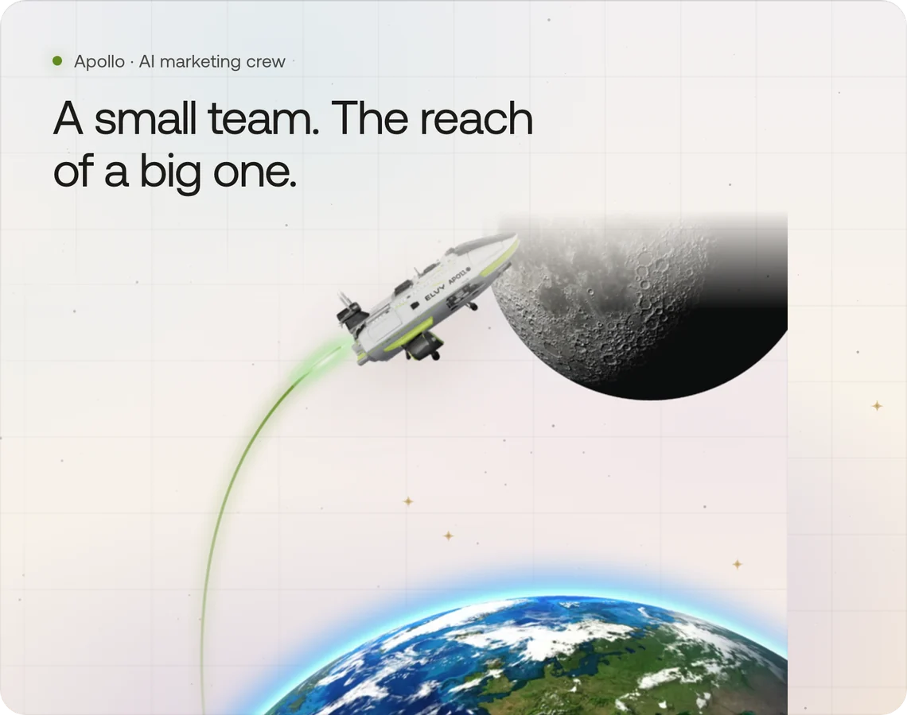</picture></a></td>
<td width="33%"><a href="#vaken-mission-control-for-claude-code"><picture><source media="(prefers-color-scheme: dark)" srcset="assets/featured-vaken.webp">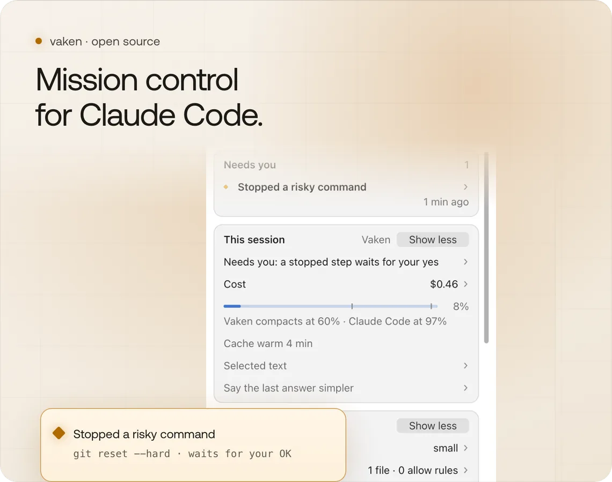</picture></a></td>
</tr>
</table>

## elvyenergy.com: a website marketing runs without a developer queue

<picture><source media="(prefers-color-scheme: dark)" srcset="assets/elvy-hero.webp">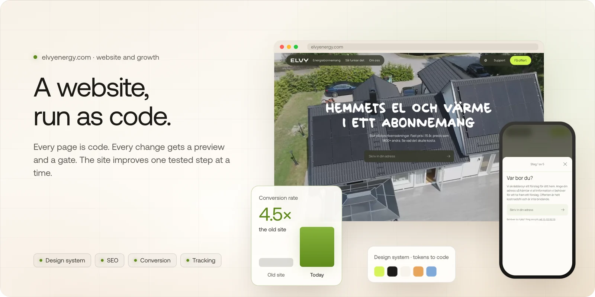</picture>

The new site, built on a new design system, went live on 10 July. I have run it end to end since: pages, SEO, conversion, content, tracking, and the links to Apollo and our sales tools.

Every change ships the same way: an agent edits the code, opens a pull request with a preview, and a gate checks it.

- **No CMS.** Every page is code, managed through Claude Code. Marketing moves without waiting in a developer queue.
- **One journey.** Onboarding looks up the house from the address, so visitors start with their own home. The path runs on to the offer and the Elvy app.
- **One gate.** No change merges without lint, types, tests, contrast and a token check. Off-brand styling cannot slip in.
- **Built for campaigns.** Wired to Apollo: a new campaign gets its own landing page fast, tracked from day one.

<picture><source media="(prefers-color-scheme: dark)" srcset="assets/uplift-dark.webp"></picture>

<table>
<tr>
<td width="50%"><picture><source media="(prefers-color-scheme: dark)" srcset="assets/elvy-site.webp">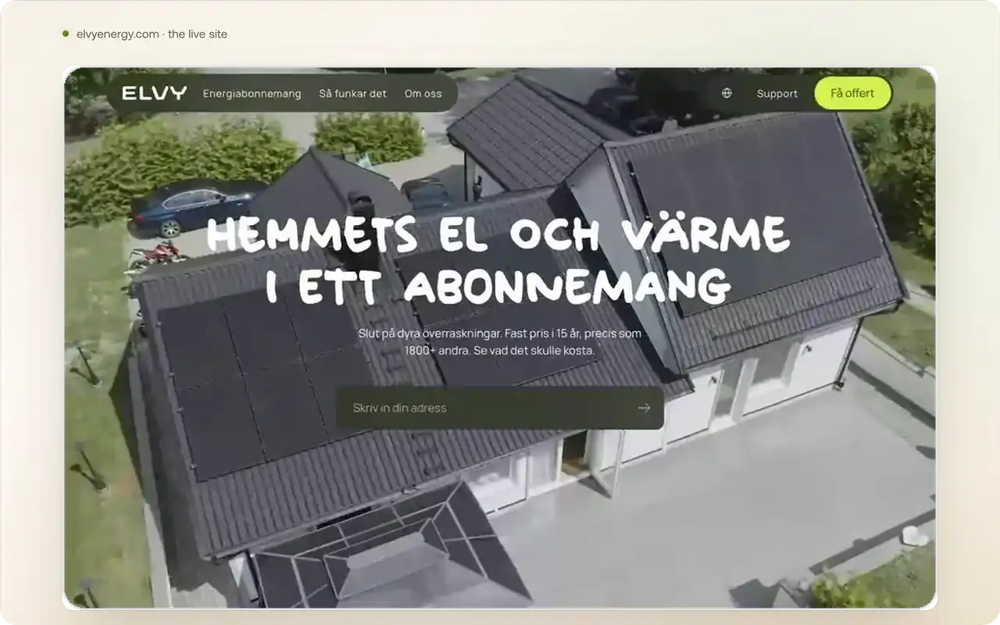</picture><br><b>The site.</b> Swedish and English, with an onboarding flow that looks up your house from your address. <a href="https://www.elvyenergy.com/">Visit it</a></td>
<td width="50%"><picture><source media="(prefers-color-scheme: dark)" srcset="assets/elvy-ds.webp">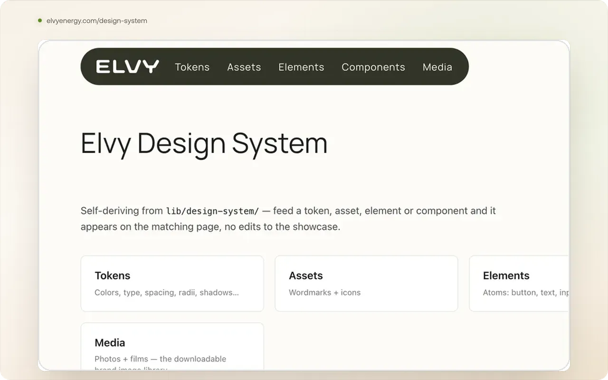</picture><br><b>The design system.</b> Public, and it renders the real components. <a href="https://www.elvyenergy.com/design-system">Open it</a></td>
</tr>
</table>

<picture><source media="(prefers-color-scheme: dark)" srcset="assets/elvy-offer.webp">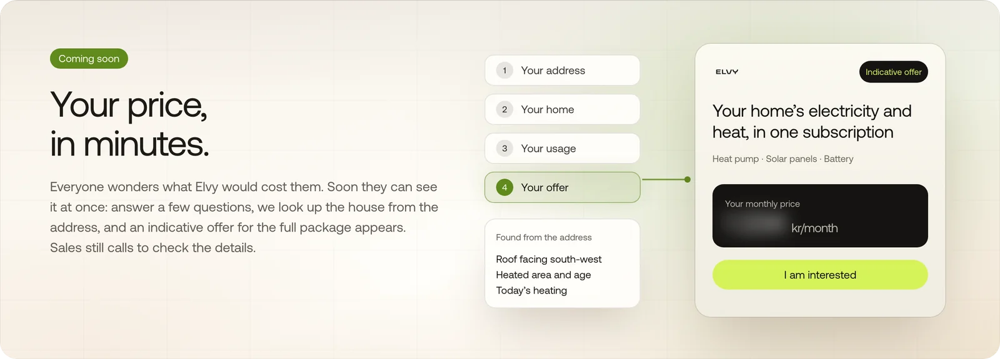</picture>

**Coming soon: your price, in minutes.** An auto-offer flow in the onboarding. After that, the whole way to a signed contract, online.

<details>
<summary><b>How the site is built and run</b></summary>
<br>

- **Figma first.** The design system came first, then mockups built from it. Then it became code: tokens for colour, type, spacing, radii and shadows, and components that use only those tokens.
- **Styling is never invented.** All tokens live in one file. A lint rule blocks any value that is not a token, so no person or model can slip in a one-off colour or margin.
- **No CMS.** You ask an AI coding agent for a change and drop in the images. It edits the right file and opens a pull request with a preview link. Nothing goes live on its own.
- **One gate for every change.** Formatting, lint, type check, tests, contrast and document structure, and a check that the generated CSS still matches the tokens.
- **Leads flow straight on.** Each lead from the onboarding flow goes to sales with the house data attached, and quiet leads get a planned follow-up in HubSpot.

Stack: Next.js (App Router), React 19, TypeScript, Tailwind v4, next-intl, React Email, Vercel. [Full write-up](https://github.com/johanmatsgard/elvy-web-case-study)
</details>

## Apollo: a small team with the reach of a big one

<picture><source media="(prefers-color-scheme: dark)" srcset="assets/apollo-hero.webp">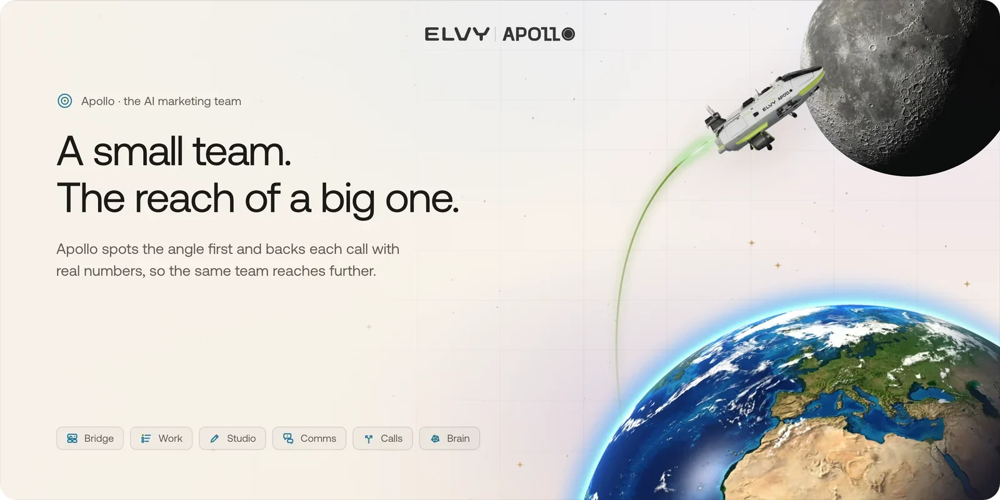</picture>

<picture><source media="(prefers-color-scheme: dark)" srcset="assets/apollo-proof.webp">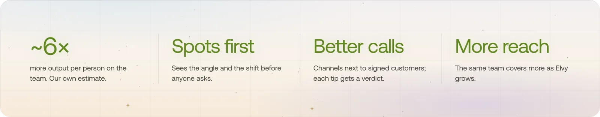</picture>

**Apollo takes the routine, so a small team can do the work of a big one.**

I build the tools our team needs, and Apollo is the biggest. It spots the angle before anyone asks, makes sure no customer question waits, and reacts while a moment still matters. Every ad channel sits next to signed customers, so each call rests on real numbers, and every recommendation gets a verdict. As Elvy grows, the same team covers more ground, so we hire for ideas, not for routine. People keep the ideas, the bold tests and the customers.

<picture><source media="(prefers-color-scheme: dark)" srcset="assets/apollo-climb.webp">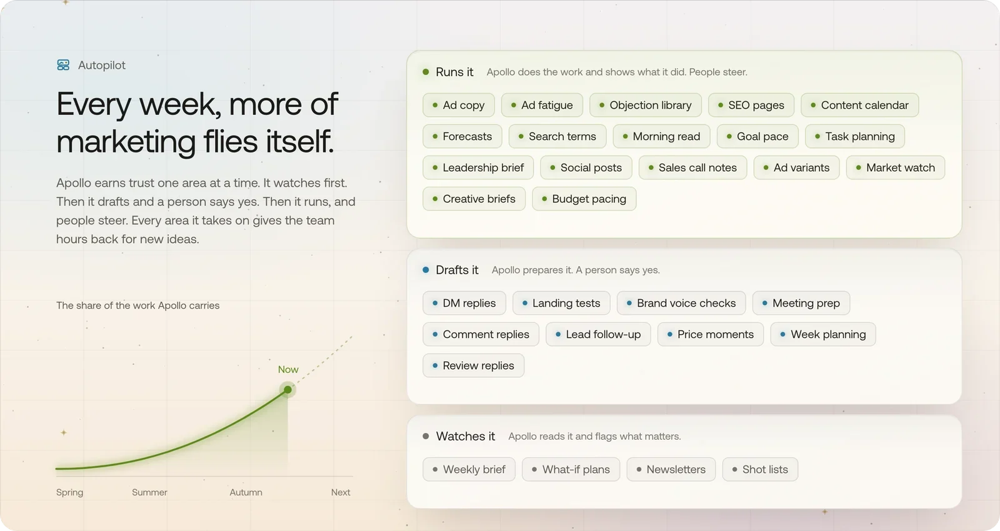</picture>

### 1. It listens

<picture><source media="(prefers-color-scheme: dark)" srcset="assets/apollo-act1.webp">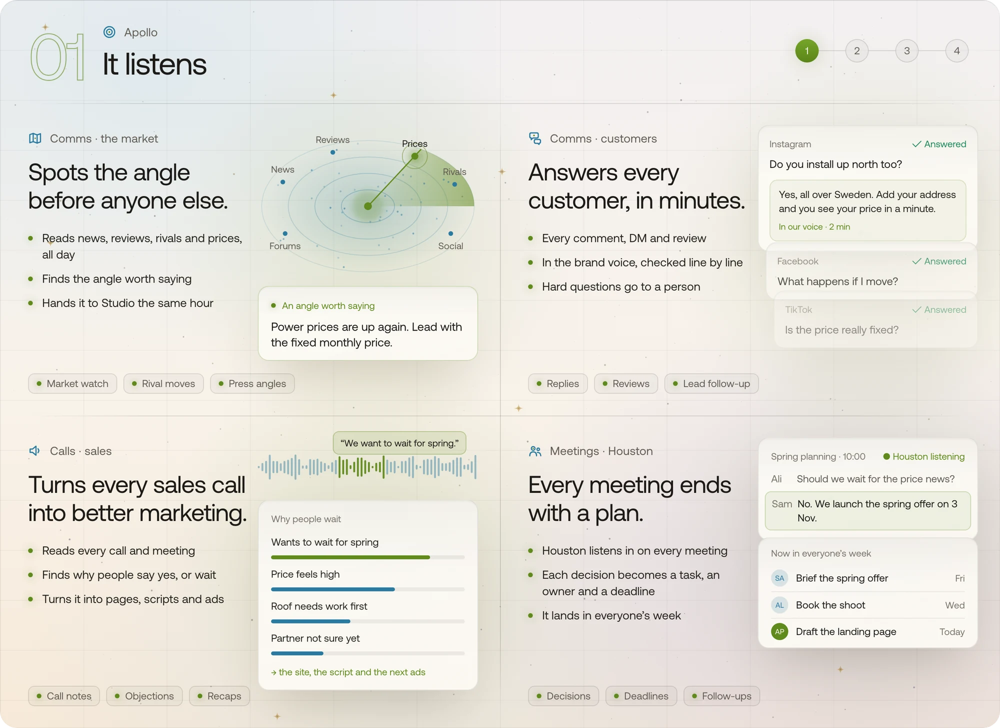</picture>

### 2. It makes and sells

<picture><source media="(prefers-color-scheme: dark)" srcset="assets/apollo-act2.webp">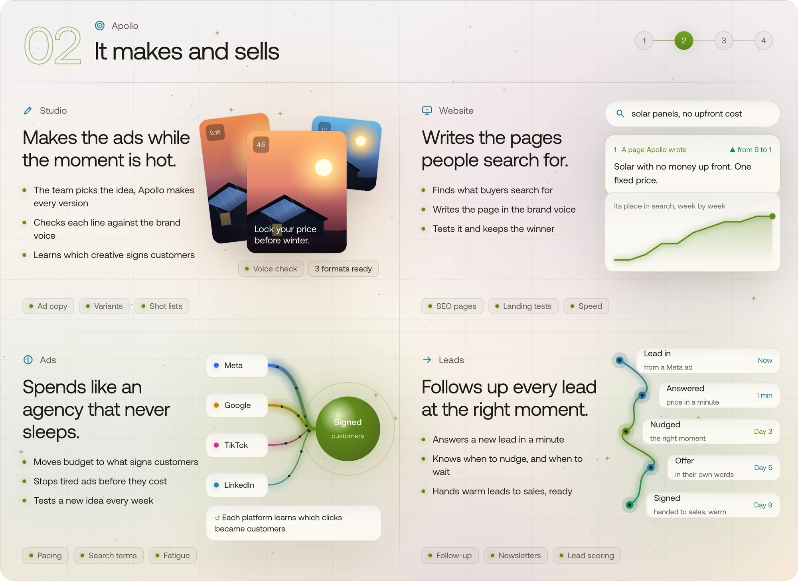</picture>

### 3. It tests and learns

<picture><source media="(prefers-color-scheme: dark)" srcset="assets/apollo-act3.webp">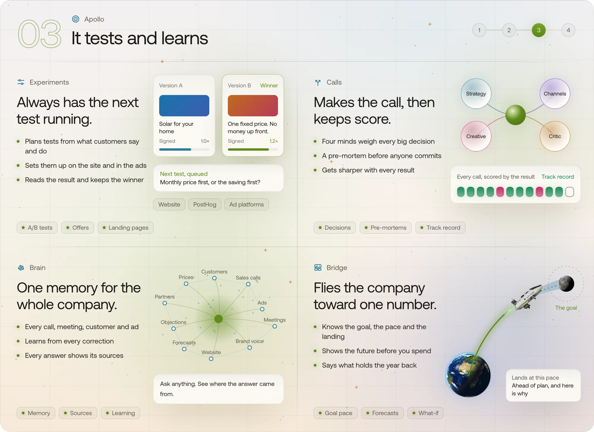</picture>

### 4. The team goes further

<picture><source media="(prefers-color-scheme: dark)" srcset="assets/apollo-act4.webp">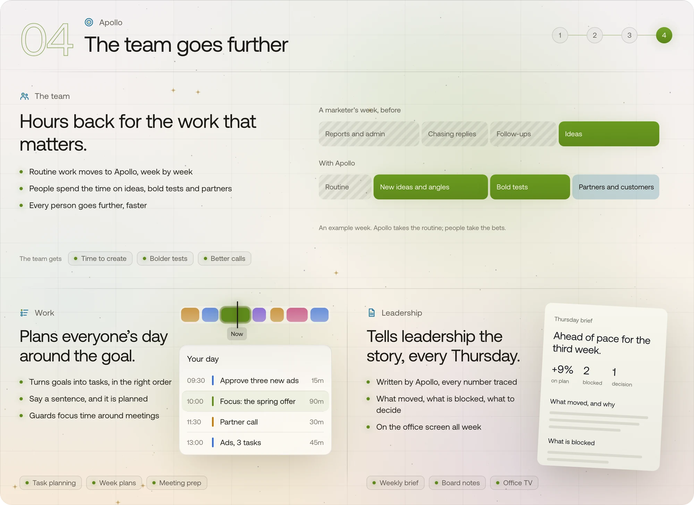</picture>

Marketing is the first part of Elvy where we let AI take us this far. We approach every other part of Elvy the same way.

<details>
<summary><b>Under the hood</b></summary>
<br>

- Meta, TikTok, Google and LinkedIn in one view, next to signed customers straight from the company's own data. Nobody types numbers in by hand.
- Channels that count conversions differently are never ranked against each other.
- Every recommendation gets a verdict: implemented, skipped or watching. Nothing is forgotten.
- Built in Claude Code loops (ship, data, brain, adoption) that I orchestrate. Every change is reviewed by hand before it ships.
- The new look: a calm night sky with Earth and the Moon, built to feel like a ship's computer.

Stack: Next.js 16, Supabase (EU), Firestore (company data), Inngest, Anthropic SDK, Vercel. [Full write-up](https://github.com/johanmatsgard/apollo-case-study)
</details>

## vaken: mission control for Claude Code

<picture><source media="(prefers-color-scheme: dark)" srcset="assets/vaken-hero.webp"></picture>

<picture><source media="(prefers-color-scheme: dark)" srcset="assets/vaken-proof.webp">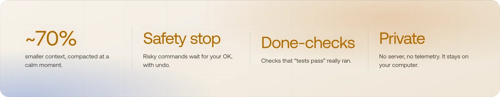</picture>

<sub>How we measured "about 70% lighter": the median of 361 compactions of sessions larger than 150,000 tokens in my own Claude Code use, October 2026. Context before the compaction against the first request after it.</sub>

Run ten Claude Code sessions and still know exactly where each one stands. vaken stops risky commands like `git reset --hard` and waits for your OK when Claude Code would not ask first, with undo. It compacts long sessions at a calm moment, so the context ends up about 70% smaller. I designed and built it alone with agents I plan and review and released it as open source, with tests on Mac and Windows on every change. No server, no telemetry.

<table>
<tr><td width="50%"><picture><source media="(prefers-color-scheme: dark)" srcset="assets/vaken-needs.webp">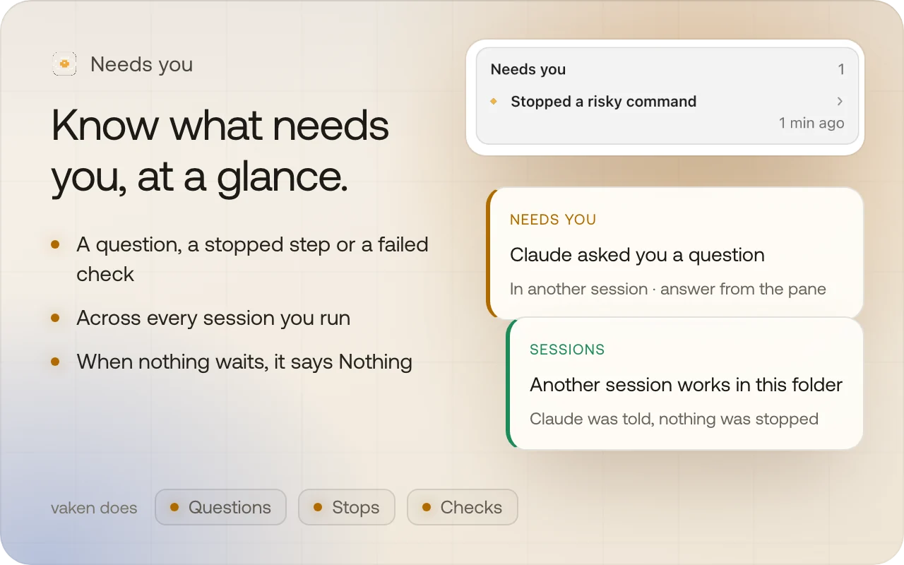</picture></td><td width="50%"><picture><source media="(prefers-color-scheme: dark)" srcset="assets/vaken-limits.webp">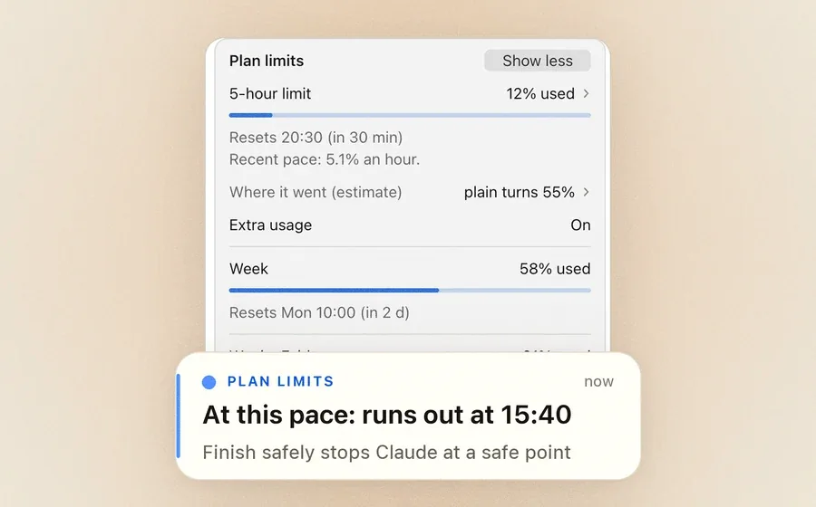</picture></td></tr>
<tr><td width="50%"><picture><source media="(prefers-color-scheme: dark)" srcset="assets/vaken-context.webp">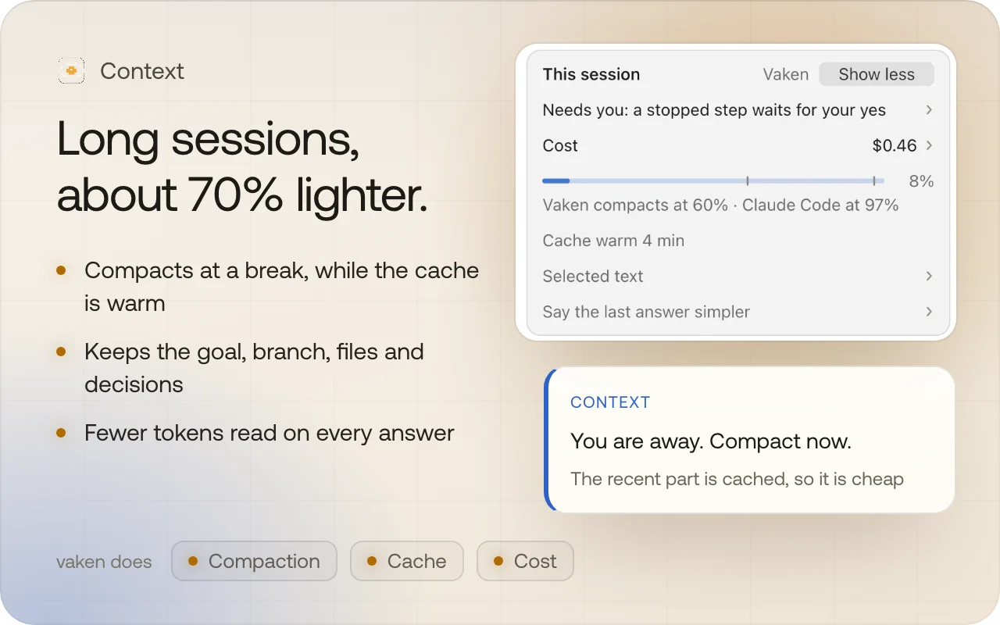</picture></td><td width="50%"><picture><source media="(prefers-color-scheme: dark)" srcset="assets/vaken-safety.webp">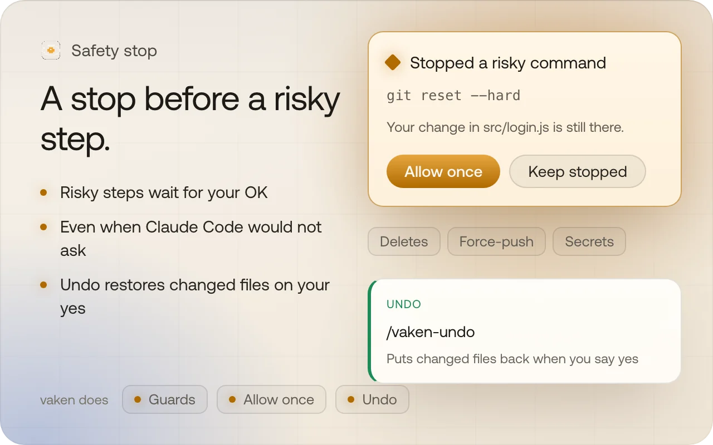</picture></td></tr>
<tr><td width="50%"><picture><source media="(prefers-color-scheme: dark)" srcset="assets/vaken-agents.webp">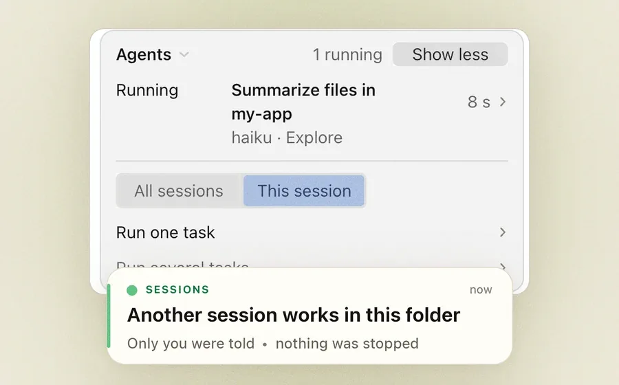</picture></td><td width="50%"><picture><source media="(prefers-color-scheme: dark)" srcset="assets/vaken-trust.webp">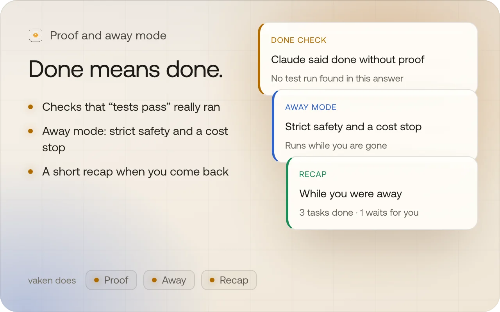</picture></td></tr>
</table>

<details>
<summary><b>How it's built</b></summary>
<br>

- **Native first.** Every size and colour is measured from Claude Code Desktop in points and kept in one tokens file. A check fails the build on any raw number.
- **Safety guards.** It reads each tool call before it runs. Deletes, force-pushes and wipes stop and wait for your OK when Claude Code would not ask first.
- **Private by design.** No account, no server. Everything stays in a local file on your computer.
- **Tested in CI.** Every pull request runs the checks on Mac and Windows before it can merge.
- **Built by one person**, with Claude Code agents that I plan, run and review.
</details>

Install it in ten seconds:

```
claude plugin marketplace add johanmatsgard/vaken
claude plugin install vaken@vaken
```

[See vaken on GitHub](https://github.com/johanmatsgard/vaken) · [Guide](https://github.com/johanmatsgard/vaken/blob/main/docs/guide.md)

## How I work

<picture><source media="(prefers-color-scheme: dark)" srcset="assets/how-i-work.webp">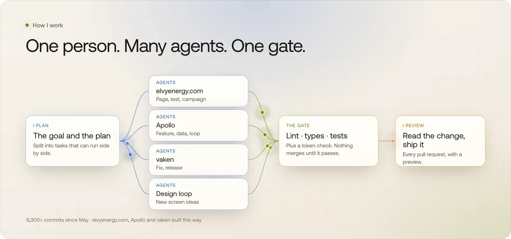</picture>

I lead the way I always have: set the goal, make the team's work count, and take away the routine. Today part of that team is AI agents. I split the goal into tasks and run many Claude Code agents side by side. A gate checks every change, and I read each one before it ships. The same method built elvyenergy.com, Apollo and vaken.

<table>
<tr>
<td width="50%"><picture><source media="(prefers-color-scheme: dark)" srcset="assets/design-loop.webp">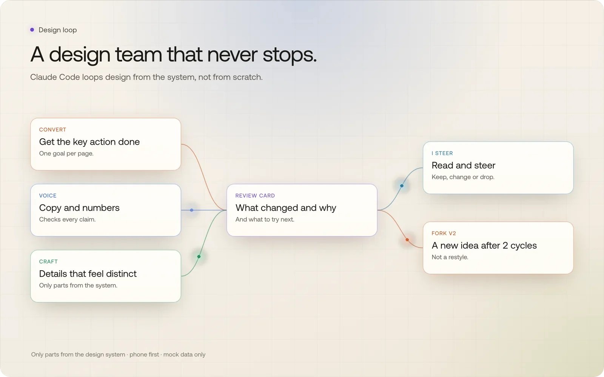</picture><br><b>Design loop.</b> A design team that never stops. Claude Code loops design new screens from the design system, test them against a goal, and fork a fresh idea after two cycles. It is how new pages for the site get designed. <a href="https://github.com/johanmatsgard/design-loop">How it works</a></td>
<td width="50%"><picture><source media="(prefers-color-scheme: dark)" srcset="assets/huskartan.webp">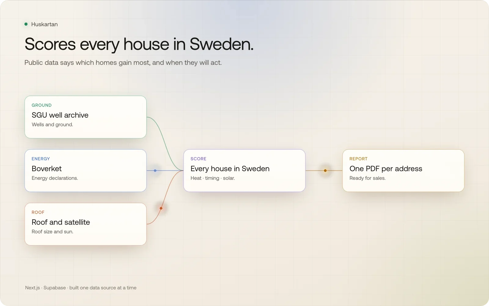</picture><br><b>Huskartan.</b> Shows which kinds of Swedish homes gain most from a new heating system or solar, from public building, energy and roof data. One PDF report per address. <a href="https://github.com/johanmatsgard/huskartan-case-study">How it works</a></td>
</tr>
</table>

<details>
<summary><b>More on the design loop</b></summary>
<br>

A design system gives you the parts. The loop decides what a page should do with them. It starts from a goal, like getting a customer to book a visit, and designs answers using only parts from the system.

- **CONVERT** gets the key action done. **VOICE** checks copy and numbers. **CRAFT** adds the details that make it feel distinct.
- Each run ends with a review card: what changed, why, and what to try next. I read it and steer.
- After two cycles the version is frozen, and the loop must try a new idea, not a restyle.
- Judged on a phone first. Mock data only.
</details>

**Now:** reading every recorded sales call to learn what makes people sign, and [testing an AI moderator on 100 Swedish social media comments](https://github.com/johanmatsgard/jev-svenska-triage).

Happy to compare notes on AI in marketing teams. [LinkedIn](https://www.linkedin.com/in/johanmatsgard/)
