<picture><source media="(prefers-color-scheme: dark)" srcset="assets/banner-dark.png">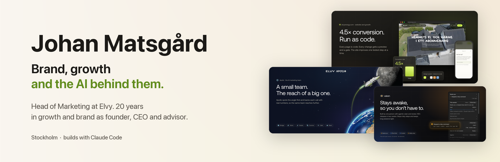</picture>

<p align="center"><a href="https://www.linkedin.com/in/johanmatsgard/">LinkedIn</a> · <a href="https://github.com/johanmatsgard/vaken">vaken</a> · <a href="https://www.elvyenergy.com/design-system">Elvy design system</a></p>

I lead marketing at [Elvy](https://www.elvyenergy.com/) in Stockholm. Before Elvy I spent many years on strategy, growth and digital transformation for global brands and fast-growing companies, B2B and B2C. I still advise founders and investors on growth.

At Elvy I own the brand and everything we say to customers: ads, partnerships, the website, content and the follow-up after a lead. I use AI to take each part further than a normal team could, and I build much of it myself with Claude Code: 6,300+ commits since May, three products in daily use.

### Latest

<table>
<tr>
<td width="50%">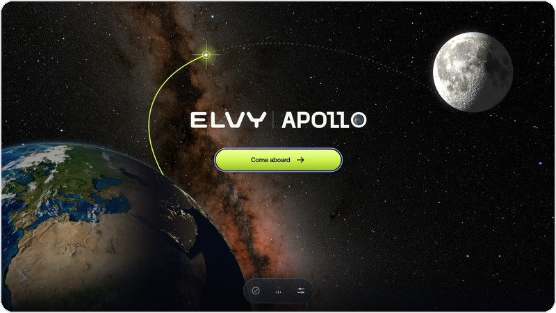<br><b>Apollo, the full picture.</b> Our AI marketing platform, now built by a team. <a href="#apollo-ai-that-takes-elvys-marketing-further">See what it does</a></td>
<td width="50%"><picture><source media="(prefers-color-scheme: dark)" srcset="assets/latest-vaken-dark.png">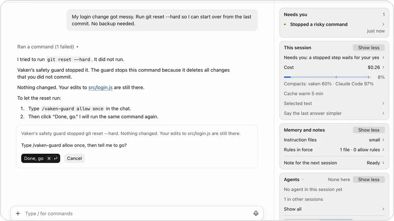</picture><br><b>vaken is out.</b> My open-source plugin for Claude Code. <a href="#vaken-mission-control-for-claude-code">See vaken</a></td>
</tr>
</table>

## elvyenergy.com: 4.5× the conversion

<picture><source media="(prefers-color-scheme: dark)" srcset="assets/uplift-dark.webp">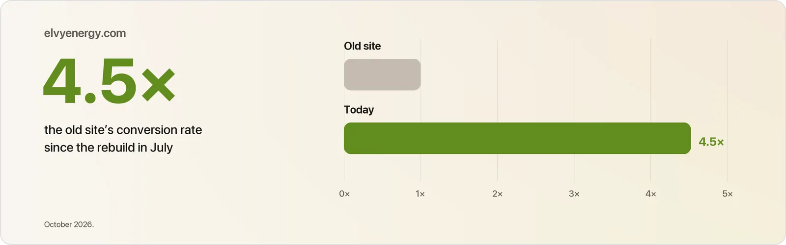</picture>

The new site went live on 10 July, built on a new design system: made in Figma, then turned into tokens, components and code. Since launch I have run it. New pages and designs, SEO, conversion work, content, tracking, and the connections to our sales tools.

Conversion more than doubled in the first month. Then it kept climbing, one tested change at a time. Today the site converts 4.5× better than the old one did, with brand-awareness campaigns left out.

<table>
<tr>
<td width="50%">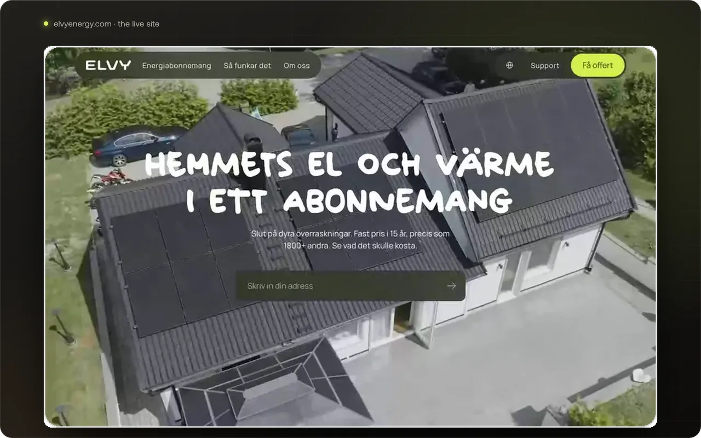<br><b>The site.</b> Swedish and English, with an onboarding flow that looks up your house from your address. <a href="https://www.elvyenergy.com/">Visit it</a></td>
<td width="50%">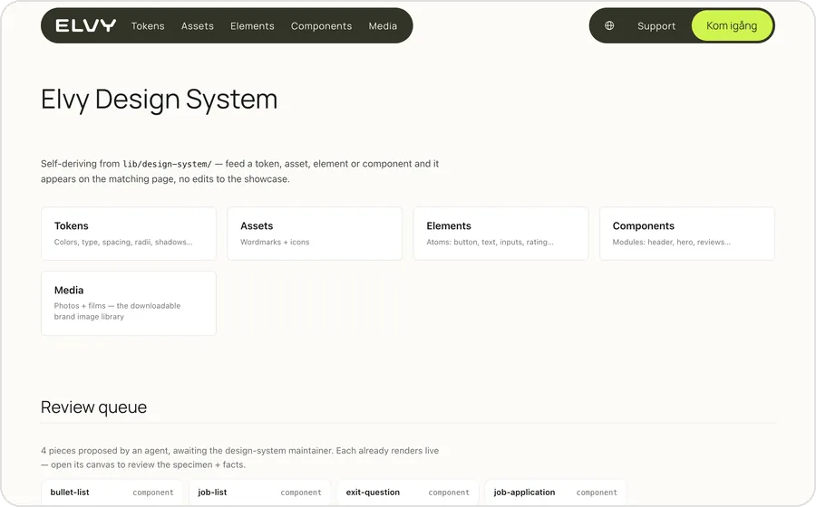<br><b>The design system.</b> Public, and it renders the real components. <a href="https://www.elvyenergy.com/design-system">Open it</a></td>
</tr>
</table>

<details>
<summary><b>How the site is built and run</b></summary>
<br>

- **Figma first.** The design system came first, then mockups built from it. Then it became code: tokens for colour, type, spacing, radii and shadows, and components that use only those tokens.
- **Styling is never invented.** All tokens live in one file. A lint rule blocks any value that is not a token, so no person or model can slip in a one-off colour or margin.
- **No CMS.** You ask an AI coding agent for a change and drop in the images. It edits the right file and opens a pull request with a preview link. Nothing goes live on its own.
- **One gate for every change.** Formatting, lint, type check, tests, contrast and document structure, and a check that the generated CSS still matches the tokens.
- **Speed to lead.** A lead is only worth something if sales calls back fast. Every new lead is contacted within five minutes, sales works from a call queue, and quiet leads get a 60-day follow-up in HubSpot.
- **Measured honestly.** Brand-awareness traffic is read apart from performance traffic, so a big brand push never hides a real gain.

Stack: Next.js (App Router), React 19, TypeScript, Tailwind v4, next-intl, React Email, Vercel. [Full write-up](https://github.com/johanmatsgard/elvy-web-case-study)
</details>

## Apollo: AI that takes Elvy's marketing further

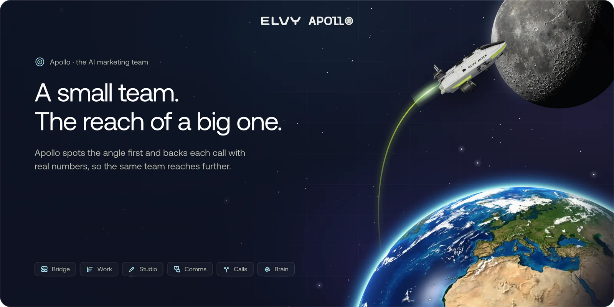

**An AI marketing team in one tool. It reads the business, makes the work, answers every customer and learns from every decision. People steer; Apollo flies.**

Apollo started as my own project: one marketing lead with the output of a full in-house team plus a performance agency. It now has a team, and we build it together. The goal is simple: automate everything that can be automated, and make every decision that is left a smarter one.

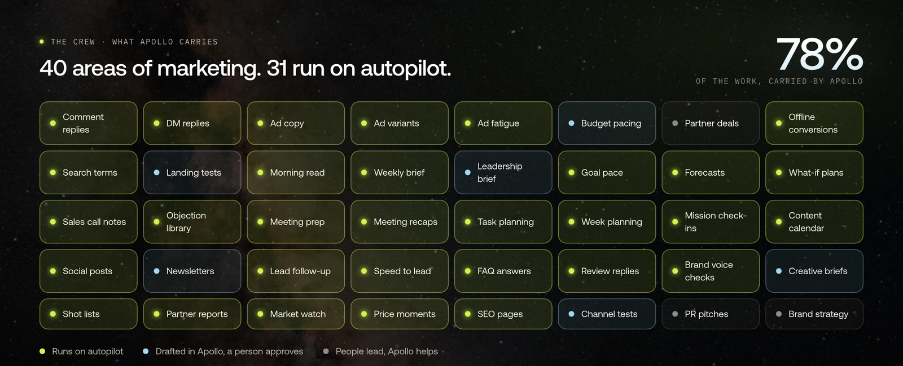

### What Apollo does

<table>
<tr><td width="50%">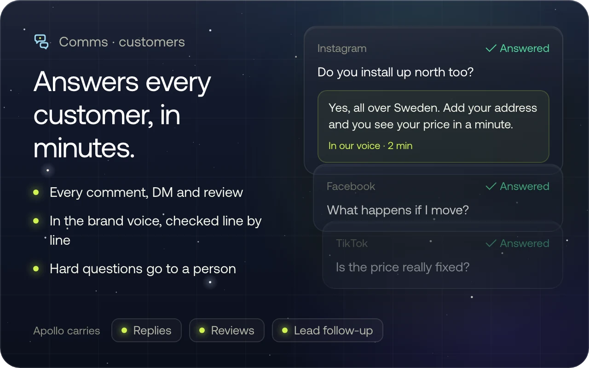<br><b>Answers every customer.</b> Comments and DMs on Instagram, Facebook and TikTok get a reply in the brand's voice within minutes. Each reply passes a voice check first.</td><td width="50%">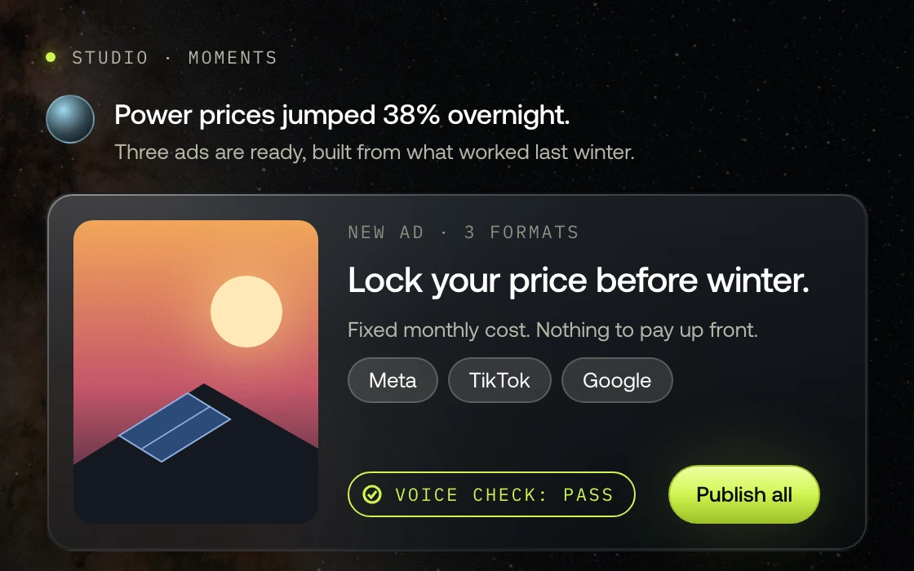<br><b>Makes ads in the moment.</b> When the news moves, Apollo builds the ads from what worked before and publishes them on Meta, TikTok and Google.</td></tr>
<tr><td width="50%">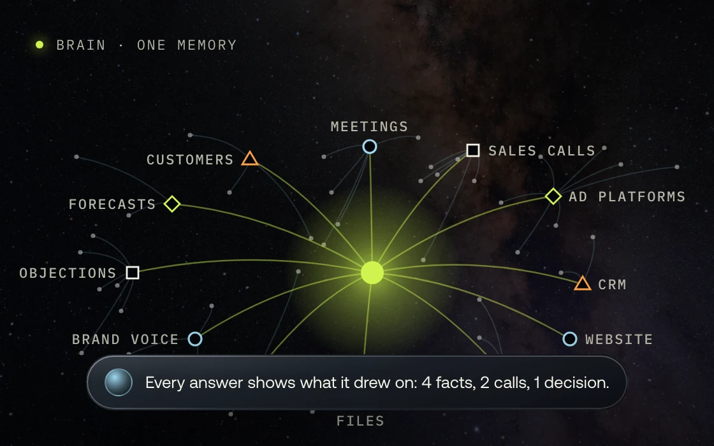<br><b>One brain behind everything.</b> Meetings, sales calls, the CRM, the ad platforms, the website and every decision feed one memory. Every answer shows what it drew on.</td><td width="50%">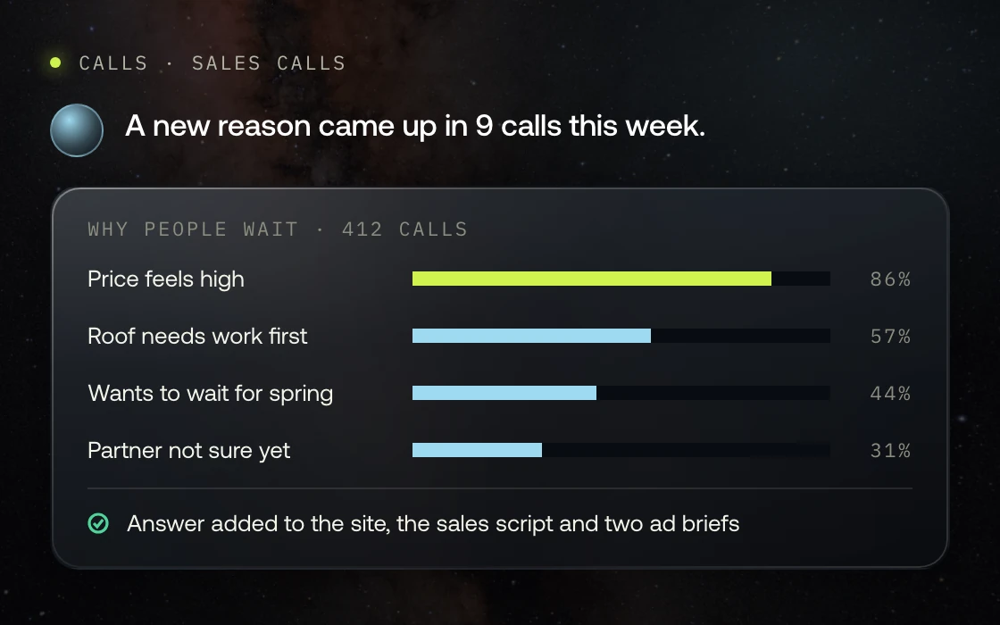<br><b>Learns from every sales call.</b> It finds why people wait or sign, and writes the answer into the site, the sales script and the next ads.</td></tr>
<tr><td width="50%">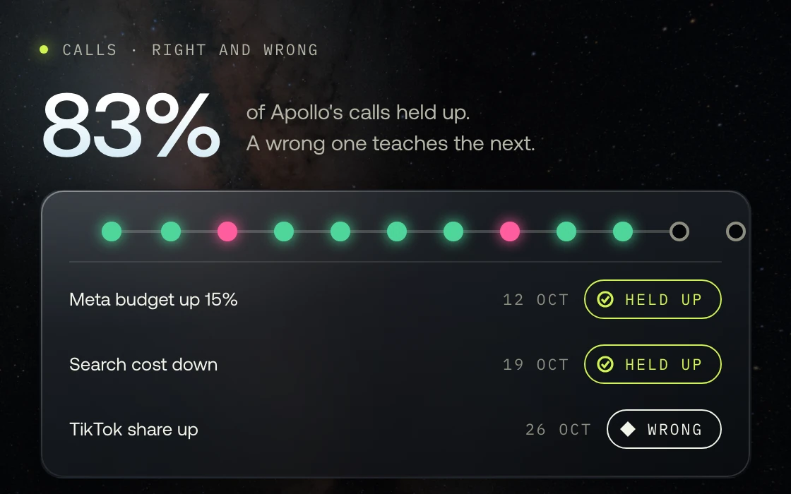<br><b>Keeps score on itself.</b> Every call Apollo makes is graded when its date comes. A wrong call teaches the next one.</td><td width="50%">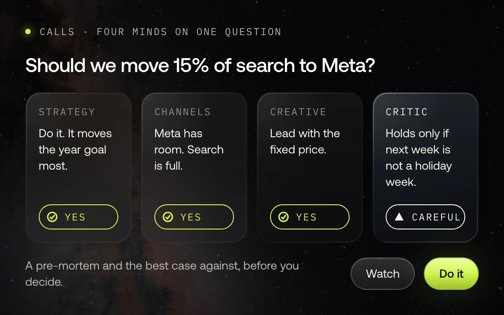<br><b>Four minds on every big decision.</b> Strategy, channels, creative and a critic weigh in, with a pre-mortem and the best case against.</td></tr>
<tr><td width="50%">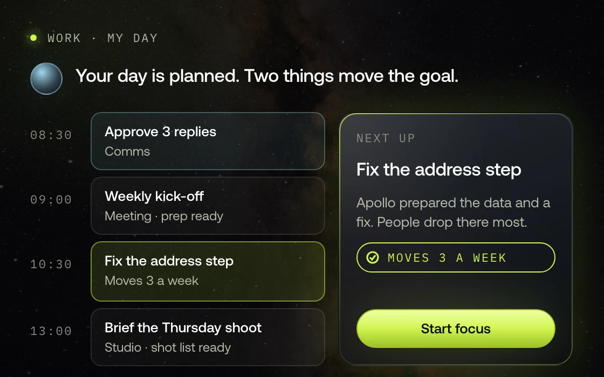<br><b>Plans every person's day.</b> Tasks, meetings and focus time land in the right slot, with the thing that moves the goal first.</td><td width="50%">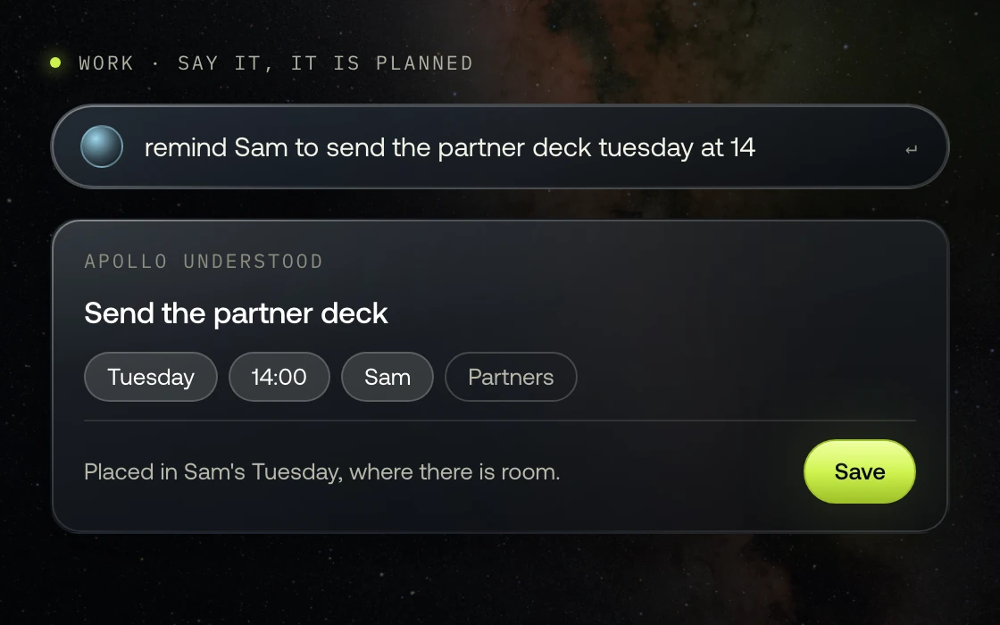<br><b>Say it, and it is planned.</b> Type or say one sentence. Apollo picks the day, the time, the owner and the project, and finds room in the week.</td></tr>
<tr><td width="50%">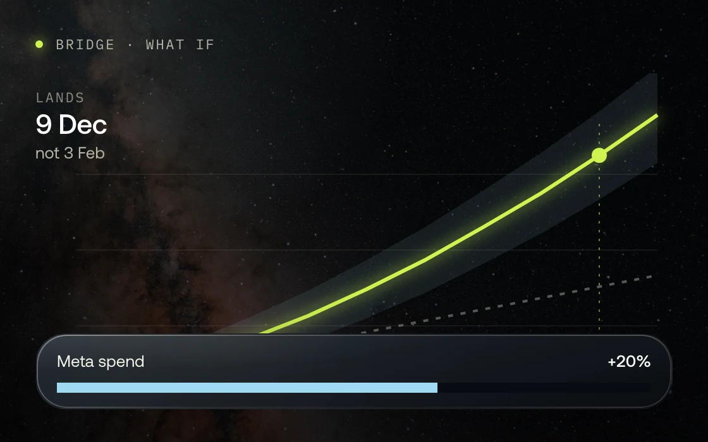<br><b>Shows the future before you spend.</b> Move a lever and watch the landing date move, from your own numbers.</td><td width="50%">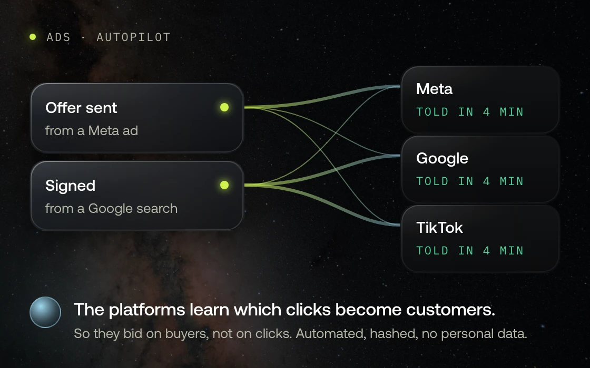<br><b>Teaches the ad platforms.</b> Offers and signings flow back to Meta, Google and TikTok on their own, so the ads chase buyers, not clicks.</td></tr>
<tr><td width="50%">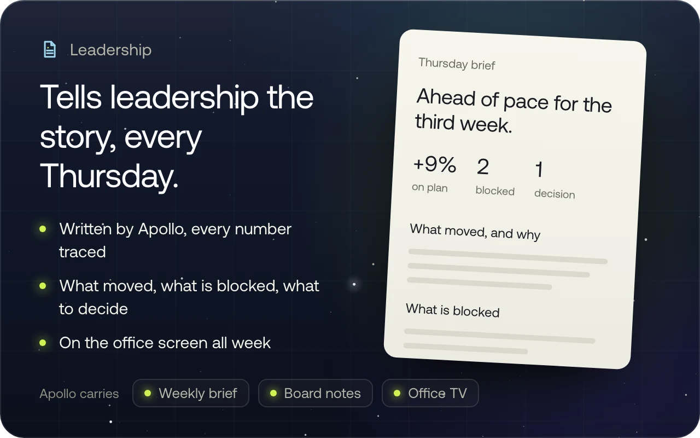<br><b>Writes the leadership brief.</b> Every Thursday, one page: numbers against the target, what moved, what is blocked and what we need.</td><td width="50%">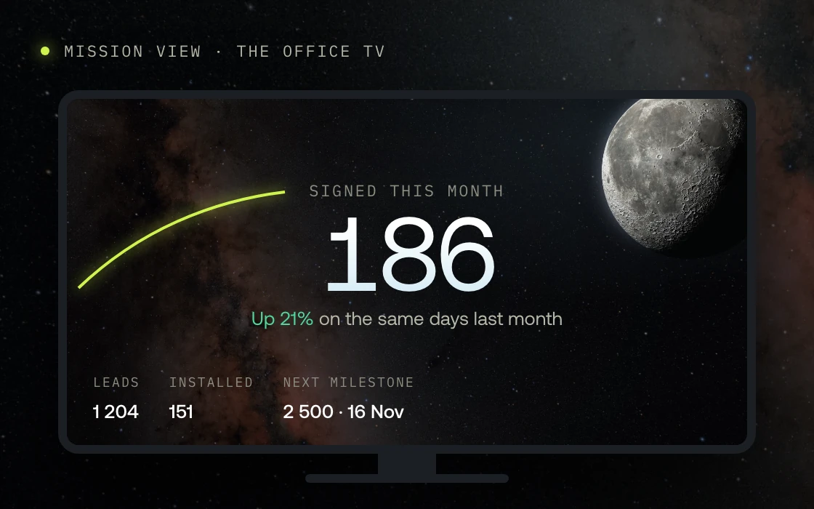<br><b>Puts the mission on the wall.</b> The office TV shows this month against the last and the next milestone. Counts only, no names.</td></tr>
</table>
<sub>Drawn with Apollo's own design system. All figures and names are made up.</sub>

<details>
<summary><b>Inside the app: Bridge, Work, Studio, Calls, Comms and Brain</b></summary>
<br>

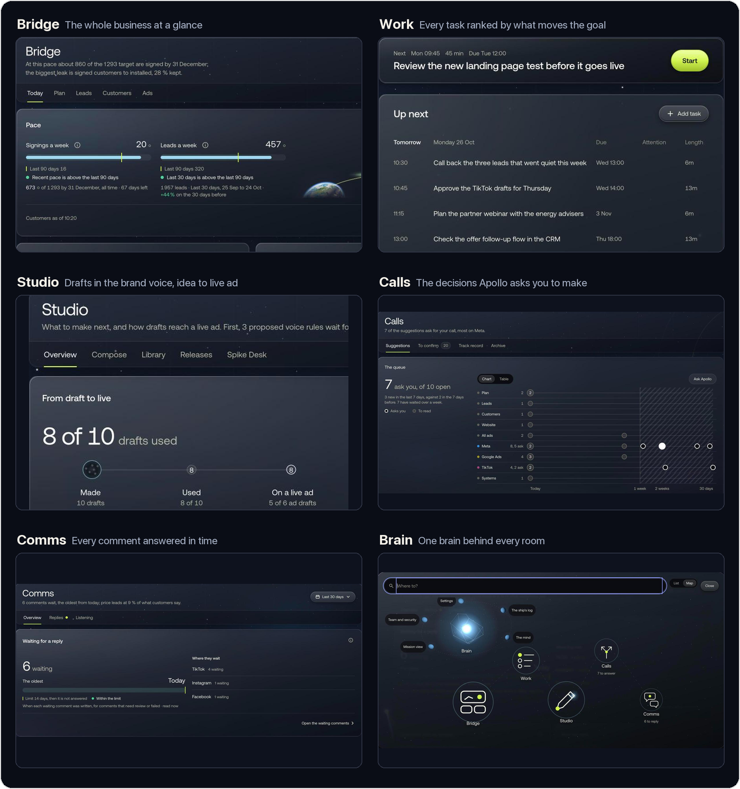
<sub>The real interface. Numbers changed and names removed, so no figure here is Elvy's.</sub>
</details>

Marketing is the first part of Elvy where we let AI take us this far. We approach every other part of Elvy the same way.

<details>
<summary><b>Under the hood</b></summary>
<br>

- Meta, TikTok, Google and LinkedIn in one view, next to signed customers straight from the company's own data. Nobody types numbers in by hand.
- Channels that count conversions differently are never ranked against each other.
- Every recommendation gets a verdict: implemented, skipped or watching. Nothing is forgotten.
- Built in Claude Code loops (ship, data, brain, adoption). Changes land on a preflight branch first and are merged by hand.
- The new look: a calm night sky with Earth and the Moon, built to feel like a ship's computer.

Stack: Next.js 16, Supabase (EU), Inngest, Anthropic SDK, Vercel. [Full write-up](https://github.com/johanmatsgard/apollo-case-study)
</details>

## vaken: mission control for Claude Code

<picture><source media="(prefers-color-scheme: dark)" srcset="assets/vaken-hero-dark.webp">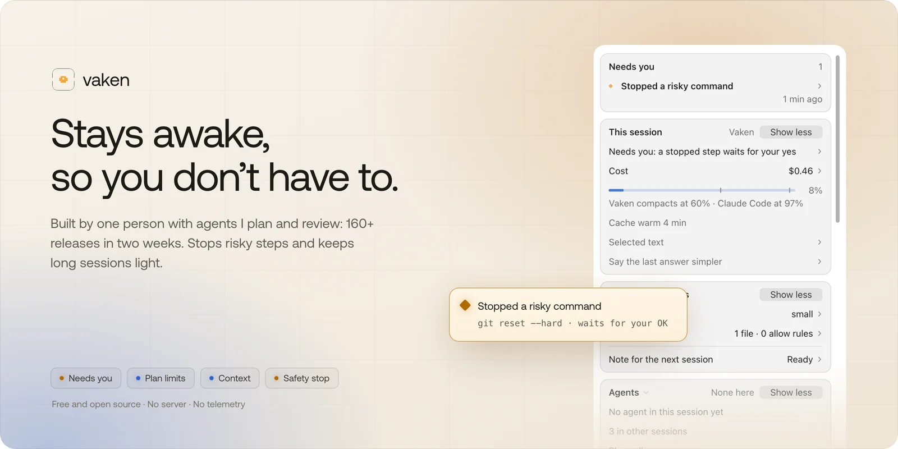</picture>

Run ten Claude Code sessions and still know exactly where each one stands. vaken is my first public plugin. It looks like part of the app, stops risky steps like `git reset --hard` when Claude Code would not ask first, and keeps all its data on your computer.

<picture><source media="(prefers-color-scheme: dark)" srcset="assets/vaken-grid-dark.webp">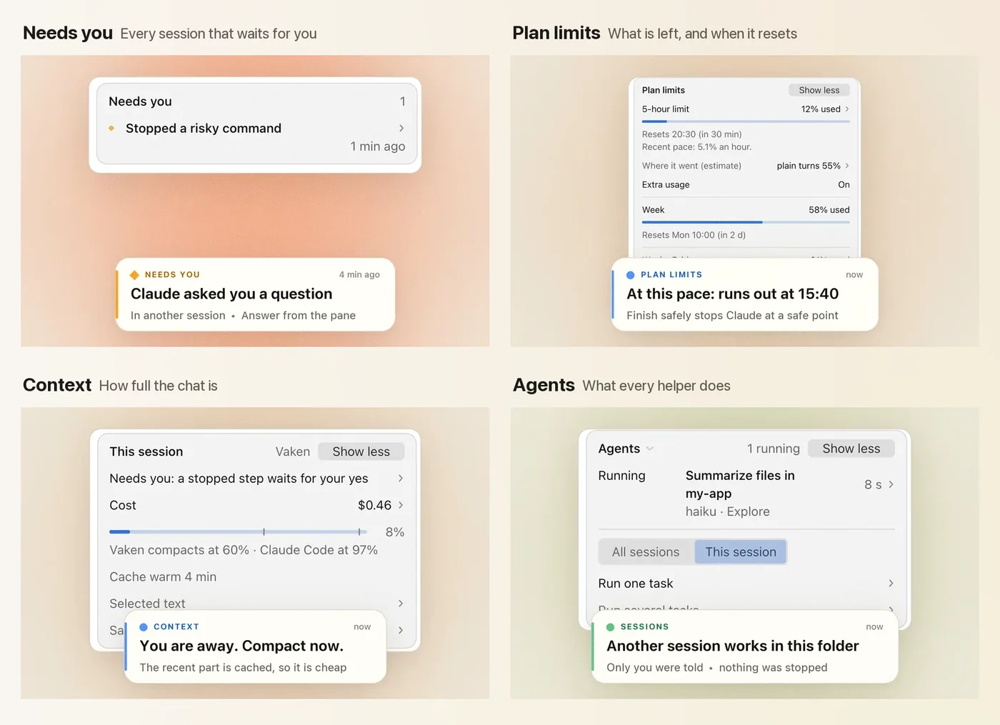</picture>

<details>
<summary><b>How it's built</b></summary>
<br>

- **Native first.** Every size and colour is measured from Claude Code Desktop in points and kept in one tokens file. A check fails the build on any raw number.
- **Safety guards.** It reads each tool call before it runs. Deletes, force-pushes and wipes stop and wait for your OK when Claude Code would not ask first.
- **Private by design.** No account, no server. Everything stays in a local file on your computer.
- **Tested in CI.** Every pull request runs the checks on Mac and Windows before it can merge.
</details>

Install it in ten seconds:

```
claude plugin marketplace add johanmatsgard/vaken
claude plugin install vaken@vaken
```

[See vaken on GitHub](https://github.com/johanmatsgard/vaken) · [Guide](https://github.com/johanmatsgard/vaken/blob/main/docs/guide.md)

## Also at Elvy

**Our customer app.** I helped design and build the Elvy app, and from here I take a much bigger part in it. I also lifted the website's design system into a kit, so the customer portal shares the site's look.

## How I work

<table>
<tr>
<td width="50%"><picture><source media="(prefers-color-scheme: dark)" srcset="assets/loop-dark.png">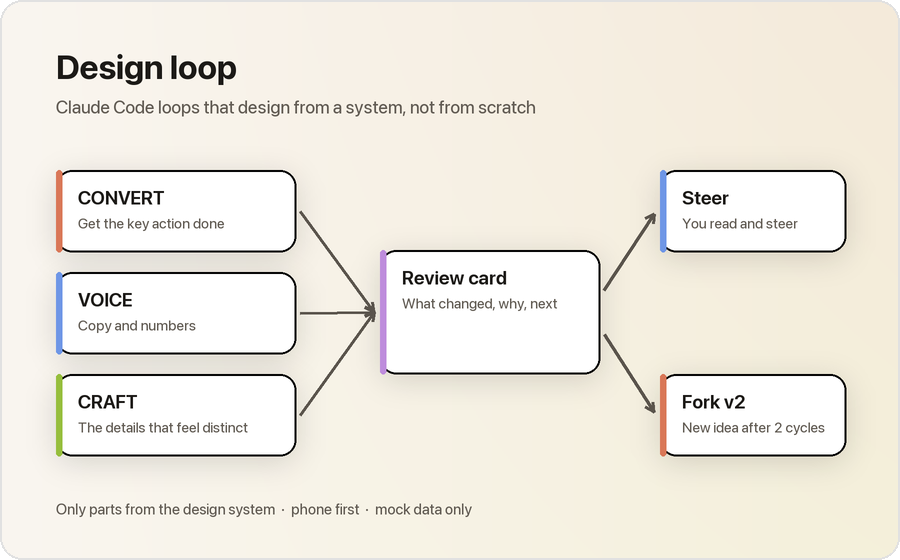</picture><br><b>Design loop.</b> A design team that never stops. Claude Code loops design new screens from the design system, test them against a goal, and fork a fresh idea after two cycles. It is how new pages for the site get designed. <a href="https://github.com/johanmatsgard/design-loop">How it works</a></td>
<td width="50%"><picture><source media="(prefers-color-scheme: dark)" srcset="assets/huskartan-dark.png">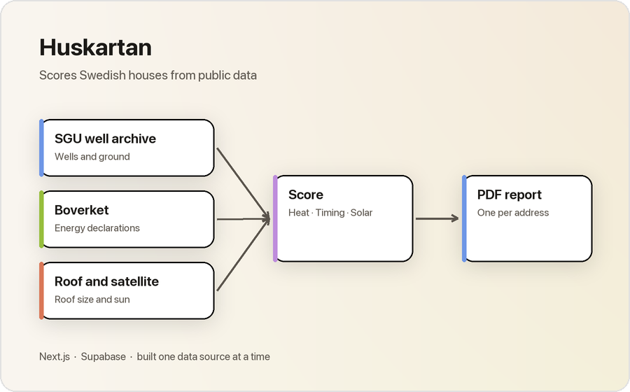</picture><br><b>Huskartan.</b> Built to score every house in Sweden. Public data tells which homes gain most from a new heating system, when they are likely to act, and how good the roof is for solar. One PDF report per address. <a href="https://github.com/johanmatsgard/huskartan-case-study">How it works</a></td>
</tr>
</table>

<details>
<summary><b>More on the design loop</b></summary>
<br>

A design system gives you the parts. The loop decides what a page should do with them. It starts from a goal, like getting a customer to book a visit, and designs answers using only parts from the system.

- **CONVERT** gets the key action done. **VOICE** checks copy and numbers. **CRAFT** adds the details that make it feel distinct.
- Each run ends with a review card: what changed, why, and what to try next. I read it and steer.
- After two cycles the version is frozen, and the loop must try a new idea, not a restyle.
- Judged on a phone first. Mock data only.
</details>

**Now:** reading every recorded sales call to learn what makes people sign (Sonnet reads, Opus reviews), and [testing an AI moderator on 100 Swedish social media comments](https://github.com/johanmatsgard/jev-svenska-triage).

Want to talk growth, brand or AI in a company? [Message me on LinkedIn](https://www.linkedin.com/in/johanmatsgard/).
